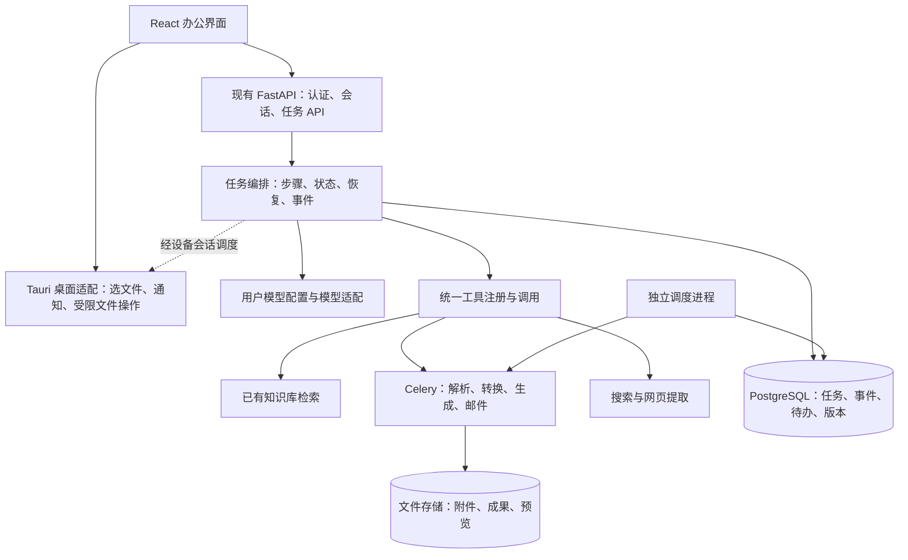

客户端改造评估与实施路线（2026-09-16）

> 当前状态见 [工作记录](WORK_LOG.md)。本文是 2026-09-16 的路线评估，不能当作全部能力已经实现。2026-09-19 已确认：客户端本地知识库与云端知识库分别管理，默认 `Xenova/multilingual-e5-small`，仅在用户主动启用本地库后安装资源，支持单独自定义向量模型；详细约束见 [本地库实施约定](LOCAL_KNOWLEDGE_BASE_SPEC.md)。

建议把 GeiIt 从知识库问答应用扩展为办公任务助手：用户在不同对话中提交任务，系统读取材料、调用工具、展示进度，最终交付可预览、可下载、可继续修改的文件，也能保存笔记、待办并定时发送提醒。现有 React、FastAPI、PostgreSQL、pgvector、Redis、Celery 基础可以继续使用。

本方案暂按 Windows 首发、保留多用户服务端、需要关闭客户端后仍可发送邮件提醒来规划。完全离线使用、macOS 首发、移动客户端属于会改变工程范围的后续决策。本次只做静态代码评估和方案设计，没有运行应用、压测或修改业务代码。

GitHub 在线调研已在 2026-09-16 重试完成：通过可访问的主题页、仓库页面、README、许可证和发布订阅核验了主要候选。API 和通用搜索页仍有限流；未安装实测第三方项目。新增 AionUi、Eigent、OfficeCLI 等更接近办公任务需求的参考，详细证据见 [GitHub 办公客户端调研](GITHUB_WORK_ASSISTANT_RESEARCH_2026-09-16.md)。

目前已有不少可复用能力，但还需要补上可靠的任务和文件成果管理。

| 能力 | 代码现状 | 改造方向 |
|---|---|---|
| 桌面界面基础 | React 18、TypeScript、Vite、Zustand；已有页面懒加载和构建分包 | 共用 React 界面，增加桌面适配层 |
| 多对话 | Conversation、Message、历史摘要、会话列表和新建对话已经存在 | 每个对话关联任务、附件、输出文件、模型配置；切换对话不终止后台任务 |
| 知识库 | 文档入库、解析、OCR、表格处理、向量检索和权限控制已有实现 | 包装成 knowledge.search 工具，供办公任务按需调用 |
| 临时文档对话 | 解析后删除临时原文件；文本限 50,000 字符，Redis 会话有效期 3,600 秒 | 保留持久附件和结构化解析结果，支持任务恢复与格式修改 |
| 模型接入 | 模型注册、健康检查、熔断、主备路由；配置主要来自 YAML/环境变量 | 增加用户配置、凭据隔离、能力检测、工具调用和结构化输出 |
| 邮件 | Resend/SMTP、邮件日志、Celery 重试和已发送检查 | 补待办、提醒规则、调度、投递状态和去重 |
| 后台处理 | Celery 已处理文档和邮件；代码配置了清理任务的 beat schedule | 增加持久任务记录、分步骤执行、恢复、取消；部署独立调度进程 |
| 文件管理 | 服务端文档上传、文件夹、重命名、移动、URL 导入已有接口 | 增加生成成果、版本、预览及桌面本地目录操作 |
| 可视化工作流 | 未发现对应工作流定义、运行或画布模块 | 后续以统一工具和任务执行器为基础增加 |

下面这些代码位置决定了改造的重点，行号对应本次评估时的文件。

| 代码位置 | 观察到的事实及影响 |
|---|---|
| `kb_qa_system/frontend/src/store/chatStore.ts:32`、`:143` | 单一全局流控制器，切换会话会调用 stopStreaming；需要按 conversation_id/run_id 管理订阅和运行状态 |
| `kb_qa_system/backend/app/api/routes/document_chat.py:76`、`:207`、`:225` | 临时文档同步解析、文本截断、清理原文件；不足以支持持久编辑和可靠的整篇转换 |
| `kb_qa_system/backend/app/core/model_provider/base.py:151` | 文本模型抽象的 invoke/astream 返回字符串，需新增结构化模型事件接口 |
| `kb_qa_system/backend/app/core/model_provider/clients/openai_text.py:234` | 把模型响应取为 content；工具调用元数据不能仅以文字传递 |
| `kb_qa_system/backend/app/services/rag_chain.py:1509` | ask_stream 内直接调用同步改写、检索、冲突检测；可能阻塞事件循环，需要实测拆分和迁移 |
| `kb_qa_system/backend/app/api/routes/chat.py:1158` | 对话详情包含全部历史消息；长对话应增加消息游标分页 |
| `kb_qa_system/backend/app/tasks/email_tasks.py:69` | 检查 sent 后调用发送，随后写回状态；并发竞争或发送成功后进程崩溃仍有重复邮件窗口 |
| `kb_qa_system/backend/app/core/celery_app.py:157` | 已定义定时清理配置，但所检查的 compose 与 entrypoint 未见启动 beat，部署是否另有调度需再核实 |
| `kb_qa_system/docker-compose.yml:108`、`:151` | 同一 Redis 实例配置 allkeys-lru，缓存、broker、结果放在不同逻辑 DB；逻辑 DB 不隔离内存淘汰 |
| `kb_qa_system/backend/entrypoint.sh:63` | 有 API 和 worker 同容器模式以共享文件；新增重型转换任务后应拆开资源并提供共享成果存储 |

**推荐先做 Tauri 2 + 现有 React 的桌面验证版本。** 它适合当前对包体和资源占用的关注；具体收益必须用同一业务场景实测。Rust 只承担文件选择、受限文件读写、系统通知、凭据存储和更新等桌面功能，主要办公处理继续在 Python 服务端。若团队更熟悉 Node 或近期需要大量 Node 桌面生态依赖，可以改选 Electron。

| 路线 | 适用情况 | 本项目需要考虑的成本 |
|---|---|---|
| Tauri 2 | 复用 React，希望减少捆绑浏览器运行时的负担 | Rust 桥接、Windows WebView2、插件适配与跨平台验证 |
| Electron | 团队以 JS/TS 为主，需要成熟 Node 桌面生态 | 捆绑 Chromium/Node，需重点控制多窗口和常驻资源 |
| PWA | 快速验证交互或继续提供网页版 | 本地文件访问与系统集成受浏览器和平台限制 |

第一版推荐“桌面界面 + 在线或企业内网服务端”。客户端关闭后，服务端任务、日程和邮件仍可继续；本地目录操作和本机模型在设备离线时则应明确显示等待设备。不要把 PostgreSQL、Redis、Celery 和完整 Python 依赖全部打进第一版 Windows 安装包。现有 Celery 继续放在 Linux 服务或容器中。

**界面围绕一个任务的完整过程设计。** 左侧放会话、待办、文件和工作流入口；中间展示需求、任务步骤、进度及错误恢复；右侧预览文档、表格、图表和修改差异。设置页增加模型连接、默认模型、个人偏好、提醒渠道和本地授权目录。第一版先提供文件预览与再次修改指令；复杂的 Word 在线编辑可后续评估 ONLYOFFICE 等独立组件。

同一用户的不同对话默认隔离任务上下文和临时附件。知识库、个人笔记和用户明确保存的偏好可以按权限引用。任务需要引用其他对话的文件时，通过明确的文件关联实现；不能把全部聊天记录默认混入新任务。已有个人/公共知识库权限规则应沿用到检索工具。

**任务运行应从聊天连接中独立出来。** 提交需求后先持久化 TaskRun，返回 run_id；客户端通过 SSE 接收文本、步骤、工具结果和成果事件。切换对话或断网只改变订阅，服务端执行继续。重新进入时先读取当前状态，再按事件游标补齐缺失内容。

- TaskRun 保存用户、会话、模型配置快照、输入文件版本、状态、成本、重试信息和时间。
- ToolRun 保存工具名称/版本、输入输出引用、步骤状态、权限范围、错误与幂等键。
- Artifact 与 ArtifactVersion 保存原附件和生成成果的存储键、类型、校验值、来源任务、预览及版本关系。大文件不塞进消息或 Redis。
- TaskEvent 保存递增事件序号，支持断线恢复；消息表只保存展示内容及相关 run/artifact 引用。
- 第一阶段先做上述实体，随后加入 Todo、Reminder、Note、ProviderConnection、ModelProfile；工作流阶段再增加定义和版本，并复用 TaskRun 执行。

建议状态为 queued、running、waiting_input、waiting_device、succeeded、failed、cancelling、cancelled。取消是明确的服务端操作：请求取消后在步骤边界停下，正在发送的邮件等外部动作不宣称可撤回。恢复运行时复用已完成的可验证步骤，并核对有副作用的步骤是否已经生效。

任务提交与入队要处理数据库和 broker 之间的双写失败，可用事务 outbox：先在数据库内同时写任务和待投递事件，再由投递器可靠推入队列。Celery 负责执行和重试，PostgreSQL 保存业务事实和恢复依据。

**先把以下工具实现为明确输入输出的内部服务，再增加第三方接入。** 模型负责理解需求、选择工具及生成内容；文件格式转换、数值计算、绘图和落盘由对应程序完成。

| 工具标识（建议） | 用户能力 | 优先复用或采用的实现 | 优先级 |
|---|---|---|---|
| knowledge.search | 查询已有企业资料并带引用 | 现有 RAG、pgvector 和权限服务 | 首期 |
| document.parse | 读取 Word、PDF、文本、表格内容 | 现有 document_pipeline；复杂版面再评估 Docling；OCR 按需启用 | 首期 |
| document.generate | 按模板生成正式文件 | python-docx（已有）、docxtpl；模型输出结构化内容后填模板 | 首期 |
| document.restyle | 统一标题、字体、页眉页脚和表格样式 | DOCX 样式映射、模板规则，保存新版本并渲染预览 | 首期 |
| file.convert | 支持声明范围内的格式转换 | LibreOffice headless 或 Gotenberg；Markdown/HTML 可评估 Pandoc | 首期 |
| sheet.inspect | 检查缺失值、重复项、单位、统计口径和公式问题 | pandas + openpyxl；规则检查后由模型解释 | 首期基础版 |
| chart.render | 用数据生成图表并插入报告 | Matplotlib；交互预览按需采用 Plotly/ECharts | 首期基础版 |
| chart.inspect | 检查图表标签、单位、结论和数据是否一致 | 先核验原始数据/图表配置，再用视觉模型检查呈现 | 第二批 |
| web.search / web.fetch | 搜索外部信息、提取网页正文和来源 | 搜索服务选一个；HTTP + 正文提取；动态网页再加 Playwright | 第二批 |
| note.save / note.search | 保存和检索用户明确记录的事项 | PostgreSQL；后续按需使用 pgvector 语义检索 | 首期基础版 |
| todo.create / todo.update | 提取并管理待办、截止日期和状态 | 新增业务服务与数据表 | 首期 |
| reminder.schedule | 一次性或重复邮件提醒 | 数据库提醒规则、调度器、已有邮件队列 | 首期 |
| files.plan / files.apply | 批量归档、重命名和修改本地文件 | 桌面桥接、变更清单、原文件校验值、备份和可撤销记录 | 第二批 |
| presentation.generate | 生成演示文件 | python-pptx 或 PptxGenJS，需配套模板和渲染检查 | 后续 |

在线调研补充：可将 [OfficeCLI](https://github.com/iOfficeAI/OfficeCLI) 纳入 Office 读写、样式检查、编辑与预览的实现候选。其根许可为 Apache-2.0，AionUi 当前文档已将其用于办公助手；本项目仍需拿中文文档、复杂公式和图表样本对比验证，暂不替换既定工具。

每个工具统一定义名称/版本、JSON Schema 输入输出、权限范围、运行位置（服务端/本机）、超时、资源上限、是否有外部副作用、幂等策略和产出文件类型。编排器只能调用已注册且当前用户可用的工具。对话任务和可视化工作流都调用同一套工具，避免两套逻辑。

先接内置工具即可，MCP 作为后续扩展协议。MCP 解决发现和调用约定，不自动提供运行隔离、可靠调度或访问权限。需要第三方 MCP 时，由服务端/桌面原生层管理连接和凭据，再接入现有工具权限体系。

**文档处理需要明确“内容、格式、视觉效果”三个验收层。** 首批支持 DOCX/Markdown/文本生成、DOCX 转 PDF、PDF 内容提取、CSV/XLSX 分析和静态图表。PDF 转可编辑 Word、扫描件还原、任意模板无损转换需要单独验证和定价，不能作为同一个通用转换承诺。

推荐流水线是：保留原文件 → 提取结构/表格/图片 → 生成或改写内容 → 应用模板 → 导出目标格式 → 渲染预览 → 检查页数、溢出、表格和图表 → 保存成果版本。页边距、页眉页脚、分页、目录和中文字体均由模板与排版工具控制。转换 worker 固定字体和渲染环境；大 PDF 逐页处理，只对确有需要的页面做 OCR。

图表检查优先使用原始数据，数值由程序计算。只有截图时，输出可见标签、趋势和估读结果，并明确无法核验精确数据；不要把视觉模型估读当作财务核对。openpyxl 不负责 Excel 公式重算，涉及公式结果的任务需要可用的重算引擎，并验证其与目标 Excel 文件的兼容性。

**提醒采用服务端持久日程。** 模型把“下周三上午九点提醒我交周报”转换为结构化待办，界面显示具体日期、时区、接收邮箱和重复规则。用户保存的提醒规则就是后续发送依据；规则不明确时再补充信息。

调度器每隔一小段时间查询到期提醒，通过行锁/原子认领防止多实例重复调度。提醒实例使用 `(reminder_id, scheduled_at)` 唯一键，写入 outbox，再投递到邮件队列。不要把数月后的提醒全部变成长 ETA 的 Celery 消息。保存时区和 UTC 下一触发时间，支持暂停、完成、改期、漏发补偿策略及失败通知。

已有邮件发送可复用，但需补充供应商幂等键（若支持）、原子认领、投递回执以及失败后的状态核对。SMTP 无法天然保证恰好发送一次；供应商接受请求也不等于用户已收到邮件。重复提醒的每次触发都应有独立投递记录，任务完成或规则改动后，发件前再次检查该实例仍有效。

**用户模型配置要覆盖能力和执行位置。** 先在现有 provider 架构上扩展，避免同时维护两套模型路由。一个连接保存供应商、Base URL、密钥引用和运行位置；一个模型配置保存模型名、上下文限制、参数以及是否支持工具调用、JSON Schema、图片和流式响应。

连接测试和模型列表是独立能力：有些兼容服务没有完整的模型列表接口，仍应允许手填模型名。提供默认对话模型、文档模型、视觉模型及每个会话/任务的覆盖设置；任务启动后保存配置快照，避免中途修改默认模型影响执行。

2026-09-17 按用户确认调整：用户模型 API Key 只在本机加密保存，云端只在当前请求内临时使用，不写数据库、缓存、日志或队列。首批实现用用户口令派生 AES-GCM 密钥，加密模型配置与本地会话；系统凭据库集成留待后续。用户设置的公共 Base URL 要进行服务端网络访问校验；企业内网模型通过管理员配置的连接策略接入。客户端关闭或锁定后，云端不能凭这些 Key 自主发起模型任务；后续后台流程应进入等待设备状态，已排定且无需模型调用的邮件提醒可以独立执行。

云服务器无法访问用户电脑上的 `localhost:11434`。本机 Ollama 需要桌面侧执行路径或明确的设备连接协议；服务端不能把其 localhost 当成用户本机。先支持云/企业内网模型，本机模型作为单独阶段。已有知识库 embedding 与索引绑定，不能像聊天模型一样随意切换；更换 embedding 模型需建立匹配的新索引并重建向量。

**工作流放在工具闭环稳定之后。** 建议采用 React Flow（`@xyflow/react`）做画布，工作流保存为有版本的 JSON 图。React Flow 只提供编辑界面，执行、恢复、权限及节点参数校验仍由后端负责。

第一版节点只需：输入/上传文件、知识库检索、模型调用、工具调用、条件判断、人工补充/确认、输出成果、创建提醒。先支持有向无环图；循环、子流程、多人审批和复杂并发后续扩展。发布前校验端口类型、必填参数、连接关系和环路。运行固定到某个版本，重试时不会静默切到新图。

例如：“每周一触发 → 读取指定报表 → 检查数据 → 生成图表 → 套周报模板 → 导出 PDF → 发送给用户”。涉及本地文件时，设备必须在线，或事先将输入材料同步到服务端。画布执行与自然语言任务统一落到 TaskRun/ToolRun，逐节点显示输入、输出、耗时与错误。可评估 LangGraph 处理模型决策和可恢复编排；Celery 继续负责重型工具任务，两者不要重复承担同一层职责。

下面是建议新增的接口分组，路径是设计草案，并非当前已实现 API。前缀继续沿用项目的 API_V1_PREFIX；现有 `/chat`、`/documents` 等接口可以通过适配逐步迁移。

| 接口组 | 建议路由 | 要点 |
|---|---|---|
| 会话 | `POST /conversations`；`PATCH /conversations/{id}`；`GET /conversations/{id}/messages?cursor=...` | 单独创建任务会话；消息分页；关联文件、模型和运行 |
| 任务 | `POST /runs`；`GET /runs/{id}`；`GET /runs?conversation_id=...` | 长任务返回 202 + run_id；按用户检查访问权限；提交支持幂等键 |
| 运行事件 | `GET /runs/{id}/events?after=...` | SSE 事件带 id、type、run_id、step_id；支持历史事件重放 |
| 控制 | `POST /runs/{id}/cancel`；`POST /runs/{id}/resume` | 取消执行与断开 SSE 分开；恢复时提交补充信息/已获授权的操作决定 |
| 文件成果 | `POST /artifacts`；`GET /artifacts/{id}`；`GET /artifacts/{id}/versions` | 上传附件、查看元数据与版本；上传后可异步解析 |
| 预览下载 | `GET /artifacts/{id}/preview`；`GET /artifacts/{id}/download` | 鉴权后返回内容或短期签名链接；禁止使用任意服务器文件路径 |
| 工具 | `GET /tools`；`GET /tools/{name}/schema` | 只返回该用户有权使用的工具和能力；正式调用统一进入任务体系 |
| 模型连接 | `POST /model-connections`；`PATCH /model-connections/{id}`；`POST /model-connections/{id}/test`；`GET /model-connections/{id}/models` | 凭据写入和脱敏读取；测试连通性/能力；允许手填模型 |
| 模型配置 | `GET/POST /model-profiles`；`PATCH /model-profiles/{id}` | 任务用途、模型参数、能力和连接引用 |
| 笔记与待办 | `GET/POST /notes`；`GET/POST /todos`；`PATCH /todos/{id}` | 区分笔记、截止日期和提醒时间；支持编辑、检索与完成 |
| 提醒 | `GET/POST /reminders`；`PATCH /reminders/{id}`；`POST /reminders/{id}/pause` | 时区、重复规则、下一触发时间、状态和通知渠道 |
| 邮件回执 | `POST /webhooks/email/{provider}` | 验证供应商签名，去重处理送达、退信等事件 |
| 工作流 | `GET/POST /workflows`；`POST /workflows/{id}/validate`；`POST /workflows/{id}/publish`；`POST /workflows/{id}/runs` | 草稿、不可变发布版本、图校验与执行 |
| 桌面桥接 | `pick_files`、`grant_directory`、`preview_changes`、`apply_changes`、`open_artifact` | 本机 IPC 能力；如需服务端派发，走经过设备认证的指令通道 |

本地文件整理先生成变更清单，再按用户选定范围应用。桌面端复核目标路径在授权目录内、源文件校验值未变化，处理同名覆盖、链接和文件被其他程序占用的情况。新增成果默认另存为版本；覆盖原文件、批量搬移等动作提供明确预览和恢复记录。网页、文件和模型输出只能作为任务输入，不能自行扩展本地读写范围。

后续需要准备的外部服务和配置如下。现在制定方案不需要提交任何密钥；实施时通过环境配置或受保护的设置界面添加。

| 外部能力 | 首期建议 | 需要准备的信息 | 是否已有基础 |
|---|---|---|---|
| 文本/工具模型 | 先选一家满足工具调用与结构化输出的供应商 | Base URL、API Key、模型名、并发/速率额度 | 已有模型适配，需补能力与用户配置 |
| 视觉模型 | 图表截图/版面检查需要时开通，可与文本供应商相同 | 图片输入能力、模型名、图片/Token 限额 | 已有 vision 接口 |
| Embedding | 继续使用当前知识库配置 | 模型/维度与索引版本 | 已有 |
| 邮件发送 | 优先复用 Resend，或现有 SMTP | 发件域名、验证配置、凭据、发件地址；回执 Webhook 配置 | 已有发送与日志 |
| 网页搜索 | Tavily、Brave Search、Exa 等选一家评估 | 搜索 Key、配额、语言/地区需求、数据使用条款 | 新增；只处理用户给的 URL 时可暂不需要搜索 API |
| 文件存储 | 单机先用现有持久卷并抽象 Storage；多实例采用 S3 兼容对象存储 | endpoint、bucket、服务端访问凭据、访问/保留策略 | 已有本地卷，未见对象存储抽象 |
| 转换服务 | 自托管 LibreOffice 或 Gotenberg | 内部服务地址、镜像、中文字体和资源限额 | python-docx 已有，转换服务新增 |
| 个人邮箱/日历 | 仅需要用户邮箱身份发信、读邮件或同步日历时再接 | Microsoft Graph / Gmail / Calendar OAuth 应用及授权范围 | 普通系统提醒不需要先做 OAuth |
| 桌面发布 | Windows 安装包与更新渠道 | 产品标识、构建环境、发布地址、应用签名与更新签名方案 | 新增 |

**性能优化与任务可靠性应在首期一起完成。** 以下是代码观察后的优先项，不代表已经测得相应性能改善。

| 优先级 | 改造项 | 验证方式 |
|---|---|---|
| 高 | 同步文档解析/OCR/转换移入 worker；流式路径的同步 I/O 先用受控线程桥接，重型计算进入任务进程 | 多人聊天和大文档并行时记录事件循环延迟、API P95、首字时延 |
| 高 | 线程/任务使用独立数据库会话；避免长模型调用占用请求级事务 | 数据库连接数、事务时长、连接池等待 |
| 高 | 缓存 Redis 与 broker 分实例；broker 使用适合队列的持久化和 noeviction 策略，容量满时明确告警/拒绝 | 缓存压力下任务不被淘汰；broker 重启和入队失败恢复演练 |
| 高 | 文档转换、OCR、邮件和交互任务按资源拆队列/worker 池 | 大任务排队时提醒仍能按目标延迟触发 |
| 高 | 任务、提醒及投递记录持久化，outbox、幂等键和恢复扫描 | 重复提交、worker 崩溃、发送后数据库写入失败等故障场景 |
| 中 | 消息游标分页、按会话缓存；Zustand 选择器订阅；长列表按需虚拟化；流式文本按短时间窗合并更新 | 1,000 条消息下切换、输入、滚动的耗时和卡顿 |
| 中 | 文件按需预览；画布、编辑器、图表库懒加载，沿用已有构建分包 | 冷启动、可交互时间、安装包大小、常驻内存 |
| 中 | 解析结果按文件哈希+解析版本缓存；修改后只重算受影响内容；权限范围参与检索缓存键 | 缓存命中率、每份文档处理成本、跨用户隔离测试 |
| 中 | 简单任务直接走确定性工具；按需开启改写/冲突检测；限制每次运行的模型步数、Token 和并发 | 每任务模型调用次数、Token 成本、P95 总耗时 |
| 后续 | 基于实际慢查询再调 pgvector 索引、连接池和批处理参数 | EXPLAIN、召回质量和吞吐共同验收 |

评估环境固定后可设置初步目标：本地缓存的会话切换 P95 小于 200ms；任务入队接口在目标负载下 P95 小于 500ms（不含上传与执行）；30 秒轮询周期下正常运行时提醒入队 P95 小于 60 秒。它们是待验证的目标，模型首字时延、转换总耗时和邮件送达不属于服务端单方面保证的指标。继续沿用 Prometheus/Grafana，并增加排队时间、步骤失败率、模型 Token、任务成本和提醒延迟。

实施顺序按可验收成果拆分，先用真实办公材料形成稳定闭环。

| 阶段 | 范围 | 完成标准 | 粗估投入 |
|---|---|---|---|
| A：现状基线与桌面验证 | 跑通现有系统；用同一页面验证 Tauri，确认登录、流式连接、选文件、下载和安装包 | 有可运行桌面验证包、基线数据、确定的首批输入输出格式 | 约 1–2 人周 |
| B：任务与成果底座 | TaskRun/ToolRun/Event/Artifact，任务队列隔离，按会话状态与模型配置 | 切换会话或重启客户端后能看到任务状态与成果；任务间不串文件 | 约 3–4 人周 |
| C：首批办公闭环 | Word 模板生成/改样式、PDF 导出、表格基础检查、静态图表、笔记/待办/邮件提醒 | 能完成“上传数据→生成报告→预览下载→修改版本→到期提醒” | 约 3–5 人周 |
| D：扩展与桌面发布 | 搜索、图表视觉检查、本地批量整理、发布签名/更新、更多模板 | 有数据引用、操作预览与恢复；安装与升级可验证 | 约 2–4 人周 |
| E：可视化工作流 | 画布、定义校验、发布版本、节点调试、定时触发、运行恢复 | 用户能搭建并重复运行一个完整工作流 | 约 3–5 人周 |

以上为熟悉该技术栈的开发者的粗估工程投入，不是排期承诺；取决于现有测试是否能跑通、文档保真度、发布平台及模板数量。A–C 大致 7–11 人周；部分界面和工具开发可并行，但任务接口和数据模型应先定下来。先用一个报告模板、一种图表、一个发件通道和一类模型供应商验收，再扩展覆盖面。

最低验收样例应覆盖：两个对话同时跑不同文件任务；关闭客户端后服务端继续运行；重启后恢复成果；提醒改期/取消；模型超时及工具失败重试；复杂中文文档分页；任务重复投递；未经授权的跨用户成果读取。文档生成还应做输出文件可打开、渲染预览及真实内容/计算结果校验，不能只看模型回复是否成功。

**GitHub 优先参考下面几类项目。** 已在线核验主要项目的功能文档、许可证和近期发布记录，尚未安装实测。新增的 AionUi、Eigent 优先级较高，详细比较与许可条件见 [在线调研记录](GITHUB_WORK_ASSISTANT_RESEARCH_2026-09-16.md)。

| 项目 | 链接 | 建议参考的部分 | 与本项目的关系 |
|---|---|---|---|
| AionUi | https://github.com/iOfficeAI/AionUi | Office 助手、成果预览、独立会话、定时任务、模型与 MCP | 与办公任务产品形态最贴近的候选；Apache-2.0 |
| Eigent | https://github.com/eigent-ai/eigent | 桌面任务执行、本地文件整理、工具、调度 | React/Zustand/FastAPI 技术栈接近；Apache-2.0 |
| Cherry Studio | https://github.com/CherryHQ/cherry-studio | 桌面 AI 助手交互、多模型配置、会话/知识库体验 | 参考客户端 UI 与桌面边界；社区版 AGPL-3.0 |
| AnythingLLM | https://github.com/Mintplex-Labs/anything-llm | 工作区、文档知识库、模型接入和助手工具体验 | 与现有 RAG 基础接近，适合比较工作区和文档入口 |
| Dify | https://github.com/langgenius/dify | 工作流、工具注册、模型管理、运行追踪 | 重点研究产品和执行设计；整体替换会引入另一套后端体系 |
| n8n | https://github.com/n8n-io/n8n | 定时/事件触发、连接器、凭据管理、错误恢复 | 适合参考提醒和自动化设计；也可评估作为外部自动化服务 |
| Langflow | https://github.com/langflow-ai/langflow | Python 组件化工作流和可视化 AI 流程 | 适合比较节点模型和调试体验 |
| LibreChat | https://github.com/danny-avila/LibreChat | 多模型对话、工具接入、文件成果交互 | 适合参考聊天如何承载任务，不必迁移现有后端 |
| LangGraph | https://github.com/langchain-ai/langgraph | 有状态任务图、检查点、暂停和恢复 | 执行框架候选，不是完整桌面产品 |
| React Flow / xyflow | https://github.com/xyflow/xyflow | React 节点画布、连线和编辑交互 | 可视化编辑器候选，不提供后端执行引擎 |
| Docling | https://github.com/docling-project/docling | 文档结构、版面、表格等解析 | 复杂文档解析候选；需比较中文、资源占用和模型依赖 |
| Gotenberg | https://github.com/gotenberg/gotenberg | 以 HTTP 服务封装文档/PDF 转换 | 可作为独立转换 worker 服务评估 |
| Tauri | https://github.com/tauri-apps/tauri | Web 界面与桌面系统能力集成 | 本方案优先验证的桌面容器 |
| OfficeCLI | https://github.com/iOfficeAI/OfficeCLI | Office 创建、查询、编辑、检查与渲染 | 统一文档工具候选，需验证格式保真；Apache-2.0 |
| OpenWork | https://github.com/different-ai/openwork | 工作区、技能/MCP 与连接服务复用 | 当前 ee/ 外 MIT，ee/ 单独许可，需按目录和版本核对 |
| QwenPaw | https://github.com/agentscope-ai/QwenPaw | 记忆、文档、定时任务、文件工作区、Tauri 桌面测试版 | 原 CoPaw URL 当前重定向至该仓库；Apache-2.0 |

建议先看 AionUi 的办公文件流程、Eigent 的相近技术架构、AnythingLLM 的知识库与定时 Agent 任务、Langflow 的 Python 可视化工作流。Cherry Studio 用于客户端体验对照，Dify 和 n8n 用于工作流与自动化设计对照。工具层加入 OfficeCLI，并保留 React Flow、LangGraph、Docling 和 Gotenberg 的评估。

在线核验发现：Cherry Studio 为 AGPL-3.0；Dify 在 Apache-2.0 基础上增加多租户和前端品牌条件；n8n 使用 Sustainable Use License 且 EE 文件单独许可。AionUi/Eigent 的 Apache-2.0，以及 AnythingLLM/Langflow/LibreChat 的 MIT，使其更适合作为优先代码评估对象。正式采用时仍应锁定版本并核对具体目录、依赖、模型权重、字体与通知要求；完整条款与近期发布证据见调研记录。

最先需要确定的产品输入是：首发平台；服务端是云部署还是企业内网；第一批真实文档与目标模板；优先输出格式；目标用户规模和并发；系统邮箱提醒还是个人邮箱代发。按本方案默认值，可以先推进 A–C：Windows + 在线/内网后端，Word/PDF/表格基础处理，系统邮箱提醒，用户自行配置模型。随后用真实任务成功率和性能数据决定本机模型、深度 Office 编辑及复杂工作流的投入。
